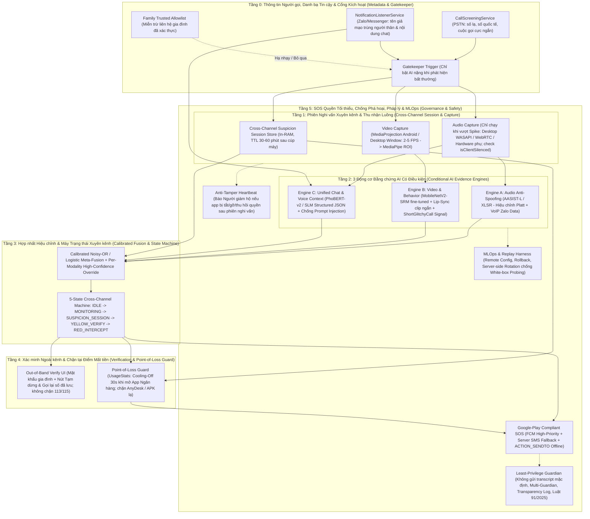
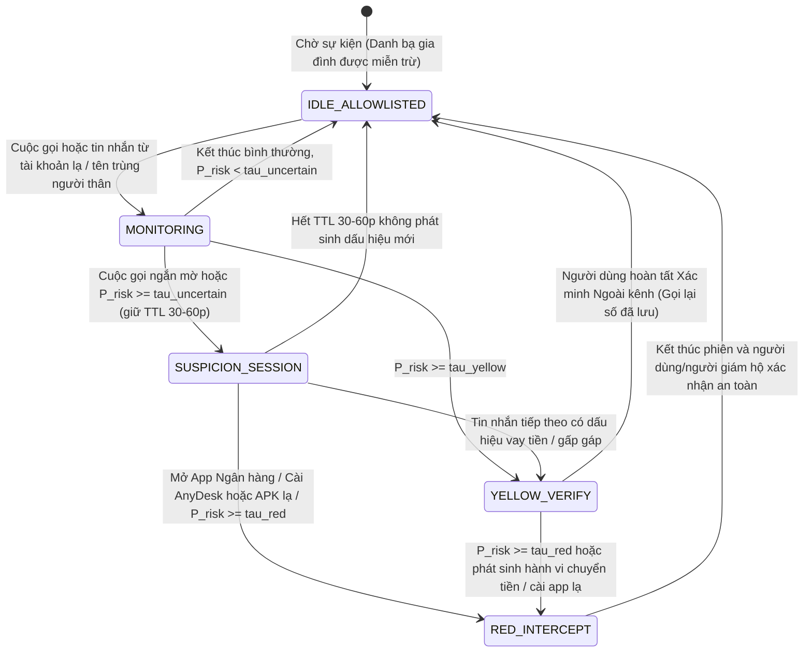
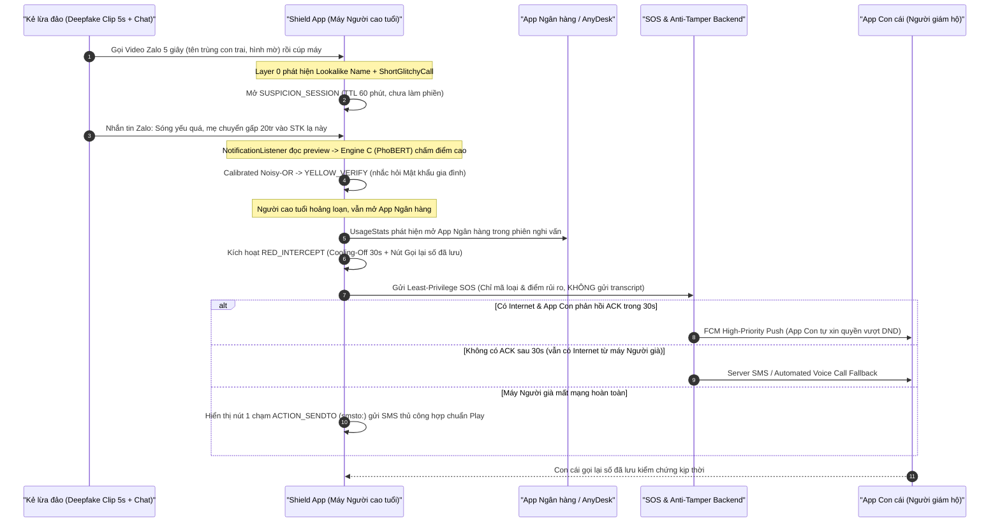

# Bản Thiết Kế Kiến Trúc Hệ Thống (v2.0) — Realtime Deepfake Shield

**Tên hệ thống:** Lá chắn Chống Lừa đảo Deepfake & Giả mạo Đa kênh Thời gian thực cho Người cao tuổi (*Realtime Deepfake Shield*)  
**Phiên bản kiến trúc:** `v2.0` (Nâng cấp sau rà soát kỹ thuật & pháp lý)  
**Tài liệu liên quan:**
* [DESIGN_REVIEW_v1.md](./DESIGN_REVIEW_v1.md) — Nhật ký rà soát 14 lỗ hổng (P0/P1/P2) của v1 và quyết định chuyển sang v2.
* [THREAT_MODEL.md](./THREAT_MODEL.md) — Mô hình mối đe dọa, ranh giới tin cậy và 8 kịch bản tấn công trọng yếu (`T1`–`T8`).
* [Kho Tài liệu Nghiên cứu](../research/README.md) ([01 Audio](../research/01_audio_deepfake_detection.md), [02 Video](../research/02_video_faceswap_detection.md), [03 Vishing STT+LLM](../research/03_vishing_stt_llm_context.md), [04 HCI & OS](../research/04_elderly_hci_and_os_constraints.md)).

---

## 1. Tóm tắt Chuyển dịch Kiến trúc (v1 → v2) & Mục tiêu Thực tế

### 1.1. Thay đổi Trọng tâm Thiết kế
Kiến trúc **v1** đặt toàn bộ niềm tin vào việc chạy AI phát hiện deepfake *trong một cuộc gọi kéo dài*. Thực tế triển khai chỉ ra 3 điểm nghẽn chí mạng: Android 10+ chặn thu âm đồng thời khi cuộc gọi VoIP hoạt động, thủ đoạn phổ biến tại Việt Nam là **gọi video mờ 3–5 giây rồi cúp máy và nhắn tin đòi tiền**, và tiền chỉ thực sự mất khi nạn nhân mở app ngân hàng hoặc cài phần mềm điều khiển từ xa.

Do đó, **Kiến trúc v2.0** tái định vị trọng tâm sang 3 nguyên tắc:
1. **Xác minh danh tính ngoài kênh là tuyến phòng thủ bất biến:** *Mật khẩu gia đình + Tạm dừng, gọi lại số đã lưu* — đứng vững trước mọi công nghệ deepfake dù chân thực đến đâu.
2. **Theo dõi Phiên nghi vấn xuyên kênh (*Cross-Channel Suspicion Session*) + Chặn tại Điểm mất tiền (*Point-of-Loss Interception*):** Liên kết dữ liệu từ cuộc gọi ngắn → tin nhắn Zalo/Messenger → hành vi mở app ngân hàng / cài `AnyDesk` / APK lạ trong khung `30–60 phút`.
3. **Các động cơ AI là nguồn bằng chứng có điều kiện (*Conditional Evidence Engines*):** Chỉ kích hoạt khi Lớp 0 phát hiện tín hiệu nghi vấn và nền tảng thực sự thu được tín hiệu sạch hợp lệ (kiểm chứng trước qua **Phase 0 Validation Spike**).

### 1.2. Đối tượng sử dụng & Chỉ số Mục tiêu (KPIs / SLOs)

* **Người dùng chính (Primary User — Người cao tuổi):** Cần trải nghiệm không làm phiền khi gọi người thân, cảnh báo trực quan dễ hiểu, không cản trở cuộc gọi cấp cứu thật (`113/115/114`) và nắm quyền kiểm soát những gì được chia sẻ.
* **Người giám hộ (Guardian User — Con cái / Người thân):** Thiết kế theo nguyên tắc **Quyền tối thiểu (*Least-Privilege*)** — nhận cảnh báo kịp thời để gọi kiểm chứng nhưng mặc định **không** nhận nội dung hội thoại riêng tư, hỗ trợ đa người giám hộ (*Multi-Guardian*) để phòng ngừa rủi ro lạm dụng tài chính người cao tuổi.

| Chỉ số mục tiêu | Ngưỡng mục tiêu v2 | Ghi chú kiểm chứng |
| :--- | :--- | :--- |
| **Tỷ lệ báo động giả Đỏ (User-centric)** | `<= 0.5 lần / người dùng / tháng` | Thay cho KPI "% theo cuộc gọi" ở v1 vốn gây *Alarm Fatigue* do base-rate của lừa đảo rất thấp |
| **Phản ứng với cuộc gọi ngắn + chat** | Phiên nghi vấn mở ngay khi phát hiện cuộc gọi `< 15s` từ người lạ; quét tin nhắn sau cuộc gọi `< 1.5s` | Bao phủ trực tiếp kịch bản gọi 3–5 giây rồi nhắn tin vay tiền theo cảnh báo Bộ Công an |
| **Độ trễ chặn điểm mất tiền** | `< 500 ms` kể từ lúc mở app ngân hàng / app điều khiển từ xa | Chặn ngay màn hình đầu tiên trước khi kịp nhập số tài khoản/OTP |
| **Độ trễ suy luận AI (khi kích hoạt)** | Audio `<= 4.0s`; Video `<= 2.5s`; Context/Chat `<= 2.0–3.5s` | Chỉ tính trên các thiết bị/nền tảng có luồng tín hiệu hợp lệ |
| **Lưu trữ dữ liệu sinh trắc học thô** | `0 bytes` ghi đĩa; **0 bytes raw media gửi lên cloud** ở bản thương mại | Tuân thủ Luật Bảo vệ dữ liệu cá nhân số 91/2025/QH15 (hiệu lực 01/01/2026) |

> **Lưu ý trung thực kỹ thuật:** Mọi ngưỡng số học (`tau_uncertain`, `tau_yellow`, `tau_red`) trong tài liệu này đều là **giá trị khởi tạo tạm thời (*Provisional Hyperparameters*)**, bắt buộc phải hiệu chỉnh lại bằng **Offline Replay Evaluation Harness** trên dữ liệu thực tế tiếng Việt trước khi phát hành.

---

## 2. Sơ đồ Kiến trúc Tổng thể 6 Tầng (High-Level Architecture v2.0)



---

## 3. Thiết kế Chi tiết 6 Tầng Hệ thống

### 3.1. Tầng 0 — Thông tin Người gọi, Danh bạ Tin cậy & Cổng Kích hoạt
Tầng này chạy siêu nhẹ (`< 1%` pin/giờ) và **hoạt động trên 100% thiết bị Android không root**:
1. **Family Trusted Allowlist (Danh bạ Gia đình Tin cậy):** Khi cài đặt, con cái gắn dấu xác thực các số điện thoại và tài khoản Zalo/Messenger chính chủ của người thân. Các cuộc gọi từ đúng liên hệ đã xác thực được miễn trừ/hạ nhạy để triệt tiêu báo nhầm và tiết kiệm pin.
2. **Phát hiện Tên Giả mạo (*Lookalike Name Spoofing*):** `NotificationListenerService` đọc tên hiển thị của thông báo Zalo/Messenger đến. Nếu tên hiển thị trùng/gần trùng tên người thân (ví dụ *"Con trai Minh"*, *"Cháu Huy"*) nhưng không khớp với liên hệ đã xác thực, hoặc đến từ số điện thoại lạ / đầu số quốc tế (`CallScreeningService`) → lập tức gắn cờ **nghi vấn mạo danh** và mở phiên theo dõi.
3. **Đọc Tin nhắn Xem trước (*Chat Preview Ingestion*):** Khi phiên nghi vấn đang mở, `NotificationListenerService` chuyển văn bản thông báo tin nhắn Zalo/Messenger/SMS đến sang **Engine C** để bắt kịch bản *"gọi chớp nhoáng xong nhắn tin vay tiền"*.

### 3.2. Tầng 1 — Phiên Nghi vấn Xuyên kênh & Chiến lược Thu nhận Thực tế
1. **Cross-Channel Suspicion Session Store:**
   * Lưu trữ hoàn toàn trong RAM với thời gian sống `TTL = 30–60 phút` sau khi cuộc gọi nghi vấn kết thúc.
   * Gom chuỗi sự kiện rời rạc vào chung một hồ sơ rủi ro: `[Tên giả mạo]` + `[Cuộc gọi video 5 giây chất lượng mờ]` + `[Cúp máy đột ngột]` + `[Tin nhắn gửi số tài khoản lạ]` + `[Người cao tuổi mở app VCB/MoMo]`.
2. **Ma trận Thu nhận Luồng Thực tế (Loại bỏ giả định sai ở v1):**
   * **Android (Không root — Thực tế mặc định):**
     * **Âm thanh:** Do chính sách *Android 10+ Concurrent Audio Capture*, khi Zalo/Messenger/cuộc gọi giữ `AudioSource.VOICE_COMMUNICATION`, ứng dụng khác sẽ nhận **buffer câm toàn số 0** mà không văng ngoại lệ. App bắt buộc đăng ký `AudioManager.AudioRecordingCallback` và kiểm tra **`isClientSilenced()`**; nếu bị silenced, **ngắt hoàn toàn Engine A** (tuyệt đối không đẩy buffer rỗng vào mô hình) và vận hành đầy đủ bằng **Layer 0 + Chat Context + `MediaProjection` Video + Point-of-Loss Guard**.
     * **Sửa lỗi AEC từ v1:** **Tuyệt đối không đặt bộ khử tiếng vang (AEC) trước Engine A**, vì chức năng của AEC là triệt tiêu âm thanh phát ra từ loa (tức xóa sạch chính giọng nói của kẻ lừa đảo).
     * **Hình ảnh:** `MediaProjection` chụp khung hình video call ở tần suất thích ứng `2–5 FPS` (chỉ bật khi có Video Call từ đối tượng chưa xác thực).
   * **Desktop Companion (Windows WASAPI Loopback / macOS ScreenCaptureKit) & App Gọi WebRTC Nội bộ:** Thu được 100% luồng Audio PCM 16kHz + Video sạch — là nền tảng chuẩn để chạy đủ cả 3 Engine AI, huấn luyện dữ liệu thực tế và làm thiết bị bảo vệ cho người cao tuổi gọi trên máy tính/tablet.
   * **Thiết bị Phần cứng Phụ trợ (Tùy chọn Phase 2+):** Loa/micro thông minh độc lập đặt cạnh điện thoại của người cao tuổi để thu âm thanh loa ngoài vật lý mà không bị OS Android khóa quyền.

### 3.3. Tầng 2 — 3 Động cơ Bằng chứng AI Có Điều kiện

#### Engine A — Audio Anti-Spoofing (Chỉ chạy khi có luồng audio hợp lệ, `isClientSilenced == false`)
* **Kiến trúc:** `AASIST-L` (ONNX INT8 cục bộ cho Tier 3) và `XLSR-Wav2Vec2 + AASIST` (dùng trong phòng thí nghiệm nghiên cứu có đồng ý).
* **Khắc phục Domain Shift:** Bổ sung bộ dữ liệu thu trực tiếp qua cuộc gọi **Zalo/Messenger thật** (chịu mất gói, codec Opus bitrate thấp, AI denoising của app gọi) kết hợp `VSASV`, `VietPrism`, `CodecFake` và **mẫu giọng người cao tuổi thật** (`arXiv:2606.04414`).
* **Hiệu chỉnh xác suất:** Đầu ra logit bắt buộc đi qua lớp **Probability Calibration** (*Temperature Scaling / Platt Scaling*) để xuất xác suất thật $p_a^{\text{cal}} \in [0, 1]$.

#### Engine B — Video Forensics & Behavioral Call Quality
* **B1 (Spatial Forensics):** `MobileNetV2 + SRM` (hoặc MobileNetV3/ConvNeXt-Tiny) được **fine-tune lại trực tiếp trên ảnh chụp màn hình Zalo/Messenger nén vỡ** (không kỳ vọng giữ nguyên nhiễu tần số cao như trên dữ liệu chưa nén).
* **B2 (Clip-Targeted Lip-Sync):** Định vị lại mục tiêu — chuyên phát hiện **đoạn video dựng sẵn / lồng tiếng giả phát lại trong 3–10 giây đầu** (đúng kịch bản phổ biến ở Việt Nam), không kỳ vọng phát hiện face-swap live kèm đổi giọng live giữ nguyên nhịp miệng.
* **B3 (Short & Glitchy Call Behavioral Signal):** Khi phát hiện cuộc gọi từ tài khoản chưa xác thực có thời lượng cực ngắn (`< 15 giây`) + độ mờ/nhòe/rớt khung hình cao + ngắt máy đột ngột → phát tín hiệu rủi ro hành vi **`ShortGlitchyCall`** ($p_b^{\text{cal}}$) đưa vào Phiên Nghi vấn, **thay vì** hạ trọng số video xuống 0 như v1.
* **B4 (Active Probing — Hạ bậc thành Tùy chọn Phụ trợ):** Chỉ hiển thị như gợi ý tùy chọn trên màn hình chi tiết, không bắt buộc người cao tuổi thực hiện vì các công cụ như *Deep-Live-Cam/FaceFusion* đã hỗ trợ mặt nạ che khuất (*occlusion mask*) và thao tác này dễ gây quá tải nhận thức.

#### Engine C — Unified Chat & Voice Context Engine (Chống Prompt Injection)
* **Đa nguồn đầu vào:** Quét đồng thời **văn bản tin nhắn Zalo/Messenger/SMS** (từ `NotificationListenerService`) và **bản ghi Streaming ASR** (`ChunkFormer` / `PhoWhisper` khi có luồng audio hợp lệ).
* **Chống Prompt Injection & Ổn định cấu trúc:**
  * *Mặc định trên Mobile (Tier 1–2):* Dùng bộ phân loại encoder nhẹ **`PhoBERT-v2` Multi-label** (không bị ảnh hưởng bởi prompt injection, RAM < 300 MB, độ trễ < 80 ms) huấn luyện trên `hoangvt2501/data_scam`, `vietnamese_sms_dataset` và hội thoại lừa đảo tổng hợp.
  * *Trên Desktop / Tier 3 (khi dùng SLM 4-bit như Qwen2.5-1.5B/3B):* Tách biệt dữ liệu thoại trong thẻ `<UNTRUSTED_INPUT>...</UNTRUSTED_INPUT>`, ép đầu ra bằng **Structured JSON Schema Constrained Decoding** (chỉ được trả về schema điểm số định sẵn), tuyệt đối không cấp quyền tool-calling hay thay đổi trạng thái hệ thống trực tiếp.
* **6 Nhãn Chiến thuật Đặc thù Việt Nam:** `Authority_Impersonation` (Giả công an/VKS/ngân hàng), `Relative_Emergency` (Người thân tai nạn/vay gấp), `Urgency_Fear` (Hù dọa/thúc ép), `Secrecy_Isolation` (Bắt giữ bí mật), `Financial_Transfer` (Đọc OTP/chuyển khoản vào tên người lạ), `Malicious_App_Install` (Dụ cài APK dịch vụ công giả / `AnyDesk` / `TeamViewer`).

---

### 3.4. Tầng 3 — Bộ Hợp nhất Hiệu chỉnh (Calibrated Noisy-OR) & Máy Trạng thái 5 Mức

#### Thay thế Công thức Trung bình Cộng của v1
Thay vì lấy trung bình có trọng số (vốn pha loãng tín hiệu mạnh và bị vô hiệu hóa khi kẻ gian cố tình làm mờ video), v2 sử dụng **Calibrated Noisy-OR** (song song có thể thay bằng *Logistic Regression Meta-Classifier* khi đủ dữ liệu Replay Corpus):

$$P_{\text{risk}} = 1 - \prod_{k \in \mathcal{M}_{\text{active}}} \left(1 - r_k \cdot p_k^{\text{cal}}\right)$$

Trong đó:
* $\mathcal{M}_{\text{active}}$ là tập các nguồn bằng chứng đang có dữ liệu hợp lệ: `{Audio, Video, ShortGlitchyCall, Chat_Voice_Context, Lookalike_Name, Financial_Behavior}`.
* $p_k^{\text{cal}} \in [0, 1]$ là xác suất đã hiệu chỉnh của nhánh $k$; $r_k \in [0, 1]$ là độ tin cậy hiệu dụng của nguồn $k$ (được tối ưu trên Replay Corpus).
* **Tính chất bảo vệ an toàn:** Nếu bất kỳ một nguồn độc lập nào có bằng chứng rất mạnh (ví dụ `Audio = 0.95` hoặc `Chat_Voice_Context = 0.93` hoặc tổ hợp `ShortGlitchyCall + Tin nhắn vay tiền`), $P_{\text{risk}}$ lập tức vượt ngưỡng cao mà **không bị pha loãng** bởi các nhánh chưa hoạt động hay mạng mờ.

#### Máy Trạng thái Xuyên kênh 5 Mức



*(Các ngưỡng `tau_uncertain`, `tau_yellow`, `tau_red` là tham số tạm thời — sẽ được chốt chính thức bằng Replay Harness để giữ `False Red Alerts <= 0.5 / user / month`.)*

---

### 3.5. Tầng 4 — Xác minh Ngoài kênh, Chặn tại Điểm Mất tiền & UX An toàn

#### 1. Tuyến Phòng thủ Chính: Xác minh Ngoài kênh (Out-of-Band Verification)
Khi vào `YELLOW_VERIFY` hoặc `RED_INTERCEPT`, giao diện ưu tiên hướng dẫn hành động **bất biến trước mọi loại deepfake**:
* Hiển thị thẻ lớn **Mật khẩu Gia đình** (câu hỏi bí mật mà chỉ con cháu thật biết, đã cài sẵn cục bộ).
* **Đổi nút hành động an toàn (khắc phục lỗi P1-8 của v1):** Loại bỏ nút `"TẮT MÁY NGAY"` (tránh cắt nhầm cấp cứu thật). Thay bằng 2 nút lớn tương phản cao (`>= 24sp`):
  * **`TẠM DỪNG — GỌI LẠI SỐ ĐÃ LƯU`** (mở quay số trực tiếp tới số di động đã lưu trong danh bạ của người thân/người giám hộ).
  * **`GỌI NGƯỜI GIÁM HỘ HỖ TRỢ`** (kết nối ngay cho con cái kiểm tra hộ).
* **Danh sách trắng khẩn cấp cứng:** Tuyệt đối không bao giờ che màn hình hoặc can thiệp các đầu số khẩn cấp **`113`, `114`, `115`**.

#### 2. Chặn tại Điểm Mất tiền (Point-of-Loss Interception)
* **Cooling-Off Overlay cho App Ngân hàng / Ví điện tử:** Khi trạng thái là `SUSPICION_SESSION`, `YELLOW_VERIFY` hoặc `RED_INTERCEPT`, nếu `UsageStatsManager` phát hiện người cao tuổi mở ứng dụng ngân hàng/ví điện tử (VCB, BIDV, Techcombank, MB, VietinBank, Agribank, ACB, MoMo, ZaloPay...) → lập tức phủ màn hình tạm dừng có bộ đếm làm nguội **30 giây**: *"Khoan chuyển tiền! Cách đây ít phút bác vừa nhận cuộc gọi/tin nhắn có dấu hiệu giả mạo. Hãy bấm nút gọi lại cho con trước khi giao dịch."*
* **Chặn Cài đặt App Điều khiển Từ xa & APK Lạ:** Theo dõi sự kiện `ACTION_PACKAGE_ADDED` và `UsageStats` cho danh sách đen (`AnyDesk`, `TeamViewer`, `RustDesk`, `AirDroid`) hoặc gói cài đặt từ nguồn không xác định (nhắm vào thủ đoạn cài app *"Dịch vụ công / VNeID giả"*). Kích hoạt `RED_INTERCEPT` + báo SOS ngay lập tức.
* **Điểm mở rộng Tra cứu Tài khoản Lừa đảo (Phase 2):** Thiết kế cổng kiểm tra số tài khoản/URL nghi vấn đối chiếu với cơ sở dữ liệu cảnh báo lừa đảo uy tín tại Việt Nam (triển khai sau khi xác minh điều khoản & API khả dụng).

#### 3. An toàn Âm thanh Cảnh báo (Chống Lộ Cảnh báo & Vòng lặp ASR)
* **Ưu tiên Rung mạnh + Overlay thị giác** trong lúc đang gọi.
* **Cấm phát giọng đọc TTS cảnh báo qua loa ngoài khi micro cuộc gọi đang mở**, tránh việc kẻ gian nghe thấy để đổi kịch bản trấn an nạn nhân và tránh tiếng TTS lọt ngược vào bộ ASR gây vòng lặp tự kích hoạt. Chỉ phát TTS khi cuộc gọi đã kết thúc (ví dụ lúc đang ở màn hình *Cooling-Off* khi mở app ngân hàng) hoặc khi đang dùng tai nghe riêng.

---

### 3.6. Tầng 5 — SOS Quyền Tối thiểu, Chống Phá hoại, Pháp lý & MLOps

#### 1. Kịch bản Thực tế Việt Nam — Biểu đồ Tuần tự (Sequence Diagram)



#### 2. Dịch vụ SOS Hợp chuẩn Google Play (Loại bỏ `SEND_SMS` tự động)
Do Google Play giới hạn `SEND_SMS` chỉ dành cho *Default SMS Handler* (và Android 15+ khóa cứng trên app sideload), hệ thống sử dụng cơ chế 3 tầng hợp lệ:
1. **Kênh 1 (Chính):** **FCM High-Priority Push** tới App Người giám hộ (trong quá trình cài đặt, App Con chủ động hướng dẫn người thân cấp quyền thông báo ưu tiên/vượt DND cho kênh báo động khẩn).
2. **Kênh 2 (Dự phòng phía Máy chủ):** Nếu App Người giám hộ không gửi tín hiệu xác nhận (`ACK`) trong `30 giây`, máy chủ tự động kích hoạt **Server SMS Gateway / Cuộc gọi tự động (Voice OTP/Brandname)** tới số điện thoại dự phòng của các người giám hộ.
3. **Kênh 3 (Dự phòng 100% Ngoại tuyến trên máy Người già):** Mở sẵn trình soạn tin nhắn hệ thống qua Intent `ACTION_SENDTO` (`smsto:`) đã điền sẵn nội dung SOS để người cao tuổi chỉ cần bấm **1 nút Gửi** (không cần quyền `SEND_SMS`).

#### 3. Quyền Tối thiểu cho Người Giám hộ (*Least-Privilege Guardian*) & Gói tin SOS
* **Mặc định KHÔNG gửi nội dung hội thoại/tin nhắn** sang máy con (phòng ngừa lạm dụng quyền giám hộ theo [THREAT_MODEL.md](./THREAT_MODEL.md) `T7`).
* **Hỗ trợ Đa người giám hộ (*Multi-Guardian*):** Cho phép liên kết 2–3 người thân đáng tin cậy.
* **Nhật ký Minh bạch (*Transparency Log*):** Trên máy người cao tuổi có màn hình chữ lớn ghi rõ thời điểm nào app đã gửi thông báo gì cho ai, kèm nút tắt/thu hồi quyền dễ thấy (có độ trễ xác nhận để tránh kẻ gian ép tắt ngay lúc gọi).

```json
{
  "alert_id": "sos_20261122_231500_4c91",
  "schema_version": "2.0",
  "timestamp_utc": "2026-11-22T16:15:00Z",
  "elderly_profile_id": "usr_parent_001",
  "event_type": "POINT_OF_LOSS_BANKING_INTERCEPT",
  "decision": {
    "state": "RED_INTERCEPT",
    "calibrated_risk_prob": 0.92,
    "active_session_minutes": 4
  },
  "evidence_codes": [
    "LOOKALIKE_RELATIVE_NAME",
    "SHORT_GLITCHY_VIDEO_CALL",
    "CHAT_URGENT_TRANSFER_PATTERN",
    "BANKING_APP_OPENED_DURING_SESSION"
  ],
  "transcript_included": false,
  "recommended_action": "Gọi lại trực tiếp bằng số di động đã lưu để kiểm chứng với Cha/Mẹ ngay."
}
```

#### 4. Chống Phá hoại (*Anti-Tamper Heartbeat*)
Ứng dụng gửi gói tin nhịp tim (*Heartbeat*) nhẹ định kỳ (và tức thời khi trạng thái quyền thay đổi) về máy chủ. Nếu trong lúc hoặc ngay sau `SUSPICION_SESSION` mà dịch vụ bị buộc dừng, quyền `NotificationListener`/`UsageStats` bị thu hồi, hoặc app bị gỡ cài đặt → máy chủ tự động thông báo cho Người giám hộ biết khả năng nạn nhân đang bị kẻ gian hướng dẫn tắt lá chắn.

#### 5. Tuân thủ Pháp lý (Luật Bảo vệ Dữ liệu Cá nhân 91/2025/QH15)
* Theo **Luật Bảo vệ dữ liệu cá nhân số 91/2025/QH15** (hiệu lực từ **01/01/2026**), giọng nói và khuôn mặt thuộc nhóm **dữ liệu cá nhân nhạy cảm**, yêu cầu sự đồng ý tường minh của chủ thể dữ liệu.
* Do người gọi bên kia không cấp đồng ý trước cho việc truyền dữ liệu sinh trắc học lên máy chủ bên thứ ba:
  * **Bản triển khai thực tế:** Tuyệt đối **cấm đẩy raw audio/video của người gọi lên cloud**. Mọi phân tích sinh trắc học (nếu được kích hoạt) phải chạy **cục bộ trong RAM trên thiết bị** và hủy ngay sau khi xuất điểm rủi ro vô danh.
  * **Bản nghiên cứu (Hybrid Cloud):** Chỉ được phép chạy trong phòng thí nghiệm với kịch bản đóng vai mà tất cả người tham gia đã ký văn bản đồng ý (*Informed Consent*) và có phê duyệt đạo đức nghiên cứu.
  * **Bắt buộc tham vấn luật sư** chuyên ngành bảo vệ dữ liệu cá nhân trước khi phát hành ra cộng đồng.

---

## 4. Phân hạng Thiết bị (Device Tiering), Compute Budgeting & MLOps

### 4.1. Phân hạng Phần cứng Android (Tránh làm giật Zalo Video)

| Hạng thiết bị | Cấu hình tham chiếu | Các mô-đun được phép kích hoạt | Giới hạn tài nguyên (Budget) |
| :--- | :--- | :--- | :--- |
| **Tier 1 (Phổ thông — Đa số người cao tuổi)** | RAM `3–4 GB`, CPU tầm thấp | **Layer 0** (`CallScreening` + `NotificationListener`) + **Engine C (`PhoBERT-v2` quantized cho Chat)** + **Point-of-Loss Guard** + **SOS** | RAM `< 200 MB`; không bật Video/Audio AI nặng khi đang gọi Zalo |
| **Tier 2 (Tầm trung)** | RAM `6 GB` | Toàn bộ Tier 1 + **`MediaProjection` + `MobileNetV2-SRM`** (`2 FPS`) khi có Video Call nghi vấn | RAM `< 450 MB`; tự động hạ về Tier 1 nếu nhiệt độ pin `>= 42°C` |
| **Tier 3 (Cận cao cấp / Cao cấp)** | RAM `>= 8 GB` + NPU/GPU | Toàn bộ Tier 2 + **Engine B (`3–5 FPS` + Lip-Sync clip ngắn)** + **Engine A (`AASIST-L` INT8)** *(nếu vượt qua Phase 0 Spike)* | RAM `< 800 MB`; *Thermal & FPS Throttler* ưu tiên tuyệt đối không làm tụt FPS cuộc gọi |

### 4.2. Hạ tầng MLOps, Replay Harness & Chống White-box Probing
1. **Offline Replay Evaluation Harness:** Bộ công cụ phát lại toàn bộ chuỗi sự kiện đã ghi (metadata cuộc gọi + video nén qua Zalo + audio + chuỗi tin nhắn + sự kiện mở app) để đo chính xác `False Red Alerts / user / month`, `Time-to-Intercept`, và kiểm thử hồi quy trước mọi lần thay đổi mô hình/ngưỡng.
2. **Remote Config & Instant Rollback:** Toàn bộ ngưỡng (`tau_*`), trọng số Noisy-OR, danh sách package app ngân hàng / remote-access và luật từ khóa được cấp phát động qua cấu hình ký số từ server, cho phép quay lui (*rollback*) trong vài phút nếu có đợt bùng phát báo động giả.
3. **Chống White-box Probing:** Không đóng gói toàn bộ luật phát hiện và mô hình tĩnh vĩnh viễn trong APK. Duy trì một phần bộ luật ngữ cảnh/hành vi trên server (chỉ nhận đặc trưng/mã sự kiện ẩn danh, không nhận raw biometric) và xoay vòng phiên bản định kỳ (red-team hằng tháng khi xuất hiện công cụ TTS/Face-Swap mới).
4. **Privacy-Preserving Telemetry:** Chỉ thu thập số đếm ẩn danh (số phiên kích hoạt, tỷ lệ bấm "Báo nhầm", độ trễ suy luận, trạng thái `isClientSilenced`), không thu thập nội dung cuộc gọi hay tin nhắn.

---

## 5. Lộ trình Triển khai Thực tế (Bắt đầu bằng Phase 0 Validation Spike)

Thay cho lộ trình 16 tuần thiếu thực tế ở v1, dự án áp dụng cơ chế **Cổng Kiểm chứng (Go/No-Go Gate)** ngay từ 2 tuần đầu:

### Phase 0 (Tuần 1–2) — Validation Spike *(Bắt buộc trước khi viết code sản phẩm)*
1. **Ma trận Kiểm chứng Thu âm/Hình trên Android thật:** Chạy app test nhỏ trên 3–4 hãng máy phổ biến tại Việt Nam (Samsung, Xiaomi, Oppo, Pixel) với Zalo, Messenger, PSTN; ghi lại bảng kết quả `AudioRecordingCallback.isClientSilenced()` và chất lượng khung hình `MediaProjection`.
2. **Kiểm chứng Layer 0 & Point-of-Loss:** Thử nghiệm thực tế `NotificationListenerService` đọc tên người gọi & tin nhắn Zalo/Messenger, và `UsageStatsManager` phát hiện mở app ngân hàng / `AnyDesk`.
3. **Đo độ Suy giảm Mô hình qua Zalo thật (Mini-Dataset 20–30 mẫu):** Dùng *Deep-Live-Cam/FaceFusion* và công cụ Voice Clone tiếng Việt gọi thật qua Zalo, thu lại đúng luồng đầu ra để đo mức tụt hiệu năng thực tế của `AASIST` và `MobileNetV2-SRM`.
4. **Pháp lý & Chính sách Play:** Rà soát [THREAT_MODEL.md](./THREAT_MODEL.md), xin ý kiến luật sư về Luật 91/2025/QH15 và đối chiếu hồ sơ quyền Google Play (`NotificationListener`, `UsageStats`, `SYSTEM_ALERT_WINDOW`, `MediaProjection`).

### Phase 1 (Tuần 3–8) — MVP Thực chiến Song song
* **Track A (Desktop Research Testbed + Replay Harness):** Hoàn thiện pipeline Python trên Windows (WASAPI Loopback + Window Capture + 3 Engine AI + Replay Evaluation Harness) làm chuẩn khoa học.
* **Track B (Android Shield MVP — Không phụ thuộc Audio VoIP):** Triển khai Layer 0 (Allowlist, Lookalike Name, CallScreening, Chat Notification) + Cross-Channel Suspicion Session + Engine C (`PhoBERT-v2` cho Chat) + Point-of-Loss Guard (Cooling-Off Ngân hàng & AnyDesk/APK) + Least-Privilege SOS (FCM + Server Fallback + `ACTION_SENDTO`) + Anti-Tamper Heartbeat.

### Phase 2 (Tuần 9–16) — Dữ liệu Thực chiến qua Zalo/Messenger & Hiệu chỉnh Fusion
* Xây dựng bộ dữ liệu đa kênh thực chiến qua Zalo/Messenger (bổ sung giọng người cao tuổi thật).
* Fine-tune & hiệu chỉnh xác suất (*Calibration*) cho từng nhánh AI; huấn luyện/hiệu chỉnh **Calibrated Noisy-OR / Logistic Fusion** trên Replay Harness đạt mục tiêu `<= 0.5 báo Đỏ nhầm / người dùng / tháng`.
* Tích hợp Engine B (`MediaProjection` Video cho Tier 2–3) và Engine A (trên Desktop / App gọi WebRTC nội bộ / thiết bị vượt Spike).

### Phase 3 (Tháng 5–6) — Đánh giá Thực địa (Pilot) & Rà soát Phát hành
* Xin phê duyệt đạo đức nghiên cứu cho thử nghiệm đóng vai (*Role-play Field Study*) với người cao tuổi và người thân.
* Chạy Red-Teaming toàn diện 8 kịch bản trong [THREAT_MODEL.md](./THREAT_MODEL.md), hoàn thiện rà soát chính sách Google Play và quy trình vận hành MLOps.
